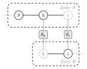
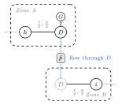
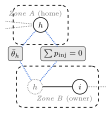

# Decomposition: sectioning and coupling

Lirion solves a distributed OPF by cutting the network into zones, letting each zone solve its own subproblem, and exchanging only boundary information until the zones agree. Two modelling choices control that exchange. **Sectioning** decides how the cut is placed and what happens to the buses and branches on the boundary. **Coupling** decides which boundary quantities the zones must agree on. This page is the theory behind those two choices; the practical side, how to pass them to `admm` or `aladin`, is in [the Getting Started page](../../usage/distributed/coupling_sectioning.md).

The motivation is not speed. A single centralized solve is the oracle Lirion measures against, and it is both faster and exact. Decomposition is for settings where no single entity may see the whole network: separate operators, markets, or privacy boundaries, where each party keeps its own data and shares only agreed boundary values. The question this page answers is: given a cut, what is the smallest piece of boundary information the zones must reconcile for their joint solution to match the centralized one?

## Consistency constraints

Partition the buses into regions ``r = 1, \dots, R`` by the `bus.zone` column. Each region solves a local OPF over its own buses, generators, and branches. Left alone, the regions are independent and their boundary variables disagree. A **consistency constraint** ties them together: wherever two regions describe the same physical quantity, their local copies must match.

Write ``x_s`` for a shared boundary quantity and ``x_s^{(r)}`` for region ``r``'s own copy of it. Each region that touches ``s`` keeps a copy, and the algorithm drives the copies to a single value ``\bar{x}_s``:

```math
x_s^{(r)} = \bar{x}_s \quad \text{for every region } r \text{ that holds a copy of } s .
```

ADMM reaches this by augmented-Lagrangian averaging with a dual price per copy [Boyd2011](@cite); ALADIN ties the copies with equality constraints in a coordinator QP and takes a Newton-like step [Houska2016](@cite). Following [Harris2022](@cite), there are three natural ways to introduce the shared copies in a power network, and Lirion implements all three as the `sectioning` options. The figures below are drawn for the copies and their consensus, so they read the same under either algorithm: a solid circle is a bus a region owns, a dotted circle is a ghost copy pulled in from a neighbour, and the dotted blue links carry each copy to the grey consensus box.

In the three cuts below the boundary state is written as the bus angle ``\theta`` and the boundary flow as the active power ``p``, as in the DC model, to keep the constraints concrete. Both are stand-ins. The shared quantities depend on the formulation: the AC model adds the voltage magnitude ``|V|`` to the state and the reactive flow ``q`` to the power, and the SOCWR relaxation carries the W-space state ``v^2``, ``R``, ``T``. So read ``\theta`` and ``p`` below as the boundary state and flow of whichever model you run; the [By formulation](@ref) section spells out what each one contains.

### Tie-line (`:tie_line`)

```@raw html
<figure style="margin:1.5rem auto;max-width:360px">
  <div style="background:#ffffff;border:1px solid rgba(0,0,0,0.12);border-radius:10px;padding:16px 12px;text-align:center">
    
  </div>
  <figcaption style="font-size:0.9em;opacity:0.72;margin-top:0.6rem">
  <strong>Tie-line (Harris Method 1).</strong> Both boundary buses live in both regions, once as the region's own bus and once as a dotted ghost; each region's copy of the boundary state is driven to agree.
  </figcaption>
</figure>
```

Each inter-zonal branch is kept, and both of its boundary buses are pulled one hop into the neighbouring region as virtual (ghost) buses with their loads and shunts zeroed. A boundary bus therefore lives in both regions. This is the overlap method: the shared quantities are the boundary-bus **states**, and the constraint equates each region's copy,

```math
\begin{bmatrix} \theta_h^{(1)} \\ \theta_i^{(1)} \end{bmatrix}
=
\begin{bmatrix} \theta_h^{(2)} \\ \theta_i^{(2)} \end{bmatrix} .
```

It keeps the most overlap between regions and is the simplest constraint to state, which tends to help convergence. It is the default sectioning for both algorithms.

### Dummy-bus (`:dummy_bus`)

```@raw html
<figure style="margin:1.5rem auto;max-width:360px">
  <div style="background:#ffffff;border:1px solid rgba(0,0,0,0.12);border-radius:10px;padding:16px 12px;text-align:center">
    
  </div>
  <figcaption style="font-size:0.9em;opacity:0.72;margin-top:0.6rem">
  <strong>Dummy-bus (Harris Method 2).</strong> The tie is cut by one auxiliary bus <em>D</em> with a zero-cost generator; each region owns one half-line, and the flow through <em>D</em> (plus its state, under <code>:hybrid</code>) is reconciled.
  </figcaption>
</figure>
```

Each inter-zonal branch is cut at its midpoint by inserting one auxiliary (dummy) bus ``D``. The branch becomes two half-lines of half the series impedance, the line charging moves to the two original endpoints, and a zero-cost generator at ``D`` makes its local power balance free. ``D`` is a real bus in the from-region, where the generator lives, and a ghost in the to-region; each region owns one half-line. The shared quantities are the dummy-bus state and the power flowing through it,

```math
\begin{bmatrix} \theta_D \\ p_D \end{bmatrix}^{(1)}
=
\begin{bmatrix} \theta_D \\ p_D \end{bmatrix}^{(2)} ,
```

so the two half-line flows meet (continuity through ``D``). Under `:power` only the flow row ``p_D`` is reconciled; `:hybrid` adds the state row ``\theta_D`` shown above. Because the defining shared quantity is a flow, dummy-bus needs a coupling that carries power and is never used with `:state`. It introduces variables the overlap method does not, which is the price of a cleaner cut.

### Split-bus (`:split_bus`)

```@raw html
<figure style="margin:1.5rem auto;max-width:300px">
  <div style="background:#ffffff;border:1px solid rgba(0,0,0,0.12);border-radius:10px;padding:16px 12px;text-align:center">
    
  </div>
  <figcaption style="font-size:0.9em;opacity:0.72;margin-top:0.6rem">
  <strong>Split-bus (Harris Method 3).</strong> The branch is owned wholly by one region; the boundary bus is cloned as a ghost into the owner. The copies reconcile the bus state and the net injection (which must sum to zero).
  </figcaption>
</figure>
```

Each inter-zonal branch is given a single owner region, the region of its to-bus, and stays there with its full impedance; the from-bus is cloned into the owner as a ghost with its load, shunt, and generation zeroed. The physical bus is thus split across the regions that share it. This method couples two things at once: the bus **state** must agree, and the regions' net **injections** at the bus must sum to zero,

```math
\theta_m^{(1)} = \theta_m^{(2)} , \qquad \sum_{r} p_{\mathrm{inj},m}^{(r)} = 0 .
```

The injection sum reconstitutes the full nodal balance at the split bus across the regions; it is a conservation condition, not a copy-equality. Both couplings live only in the hybrid workspaces, so split-bus requires `:hybrid`. A bus shared by three or more regions is handled the same way, as one group of copies summed to zero. It carries the heaviest per-iteration bookkeeping of the three methods.

## Coupling: which quantities are shared

Sectioning fixes *where* the copies live; coupling fixes *which* boundary quantities become shared:

- `:state` reconciles the boundary-bus voltage state.
- `:power` reconciles the boundary branch flows.
- `:hybrid` reconciles both.

What "state" and "power" mean is model-dependent, which is the subject of the next section. Not every coupling works with every sectioning: `:state` needs the shared buses that only `:tie_line` keeps; `:dummy_bus` reconciles a flow, so it needs `:power` or `:hybrid`; `:split_bus` needs `:hybrid`. The full matrix, including the ALADIN + SOCWR exception, is in [the Getting Started page](../../usage/distributed/coupling_sectioning.md#Supported-combinations).

## By formulation

The decomposition structure above is identical for every model. What changes is the *content* of the shared variables, because each formulation carries a different description of a bus.

### DC approximation

The DC approximation carries only the bus angle. The boundary state is the angle ``\theta``, `:power` reconciles the active flow ``p``, and both the regional subproblems and the ALADIN coordinator QP stay linear or quadratic. It is the lightest distributed model, and the one [Harris2022](@cite) itself studies.

### AC polar

The AC model carries the full complex voltage. The boundary state is the angle ``\theta`` and the magnitude ``|V|``; `:power` reconciles the active and reactive flows ``p`` and ``q``. The angle is averaged as a **circular** mean, so the wrap at ``\pm\pi`` is handled correctly, while the magnitude is averaged arithmetically. The second-order behaviour and the globalizations are covered on the [ALADIN](aladin.md) page.

### SOCWR, and its limitations

SOCWR is the Jabr second-order-cone relaxation [Jabr2006](@cite). It lifts the problem into the **W-space**: a bus is described by the squared voltage magnitude ``v^2 = |V|^2``, and a branch by the real and imaginary voltage-product terms ``R`` and ``T``, tied by a second-order cone. Under `:state` the boundary state is ``v^2`` (and, on a tie-line, the branch terms ``R`` and ``T``); `:power` reconciles ``p`` and ``q``.

Centralized, SOCWR is a valid convex relaxation and matches the reference solution. Distributed, it behaves differently under the two algorithms, and that difference is why the next model, SOCWRNL, exists.

Under **ADMM** the conic SOCWR is fine: ADMM only needs each region's conic subproblem solved and the copies averaged, which the conic solver does. It supports `:tie_line`, `:split_bus`, and `:dummy_bus`.

Under **ALADIN** it is limited, and the cause is structural. The coordinator takes a Newton-type step built from each subproblem's second-order (curvature) information, but for the conic model that curvature never reaches it: the cones' Lagrangian Hessian is not assembled into the coordinator QP, which sees only a diagonal stand-in plus the cones' first-order active-face normals. In Lirion's runs the consequence is that the coupling step makes almost no progress, the active set at the cones fills up, and the iterates settle near the conic solver's interior-point accuracy, on the order of ``10^{-4}``, short of the tight stationarity tolerance, so the method stops improving before it has truly converged in the ALADIN sense. ALADIN therefore rejects `:dummy_bus` on SOCWR, where the coordinator QP settles on a relaxed point. This is a limitation of the conic *representation* under ALADIN's Newton-type coordination, not a defect in the relaxation itself; centralized SOCWR is unaffected.

### SOCWRNL

SOCWRNL solves the **same** W-space relaxation, but writes the cones as smooth constraints and hands the subproblem to a nonlinear solver. That restores the curvature the coordinator needs and gives measurable subproblem duals, so in Lirion's runs ALADIN certifies convergence on SOCWRNL across the same sectioning and coupling set as DC and AC. The rule of thumb: reach for `socwrnl()` when you want the Jabr relaxation inside ALADIN; the conic `socwr()` is for centralized solves and for ADMM.

## How the consensus is enforced

Both algorithms reach the consistency constraint iteratively, but by different means:

- **ADMM** [Boyd2011](@cite) augments each region's objective with a quadratic penalty on the mismatch between its copies and the stored consensus value, solves the regions in parallel, updates the consensus by averaging the copies, and raises a dual price per copy. It needs only first-order information and is robust, which is why it carries the conic SOCWR.
- **ALADIN** [Houska2016](@cite) solves the same regional subproblems, then takes a coordinated step: each region reports local sensitivities (the gradient and Hessian of its Lagrangian) and its active constraints, and a central coordinator QP ties the copies with equality constraints and computes a joint update. It converges faster near the solution, but needs the second-order information the conic SOCWR cannot supply.

The algorithm-specific detail (the ``\rho`` update and stopping rule for ADMM, the globalizations and coordinator QP for ALADIN) belongs on the [ADMM](admm.md) and [ALADIN](aladin.md) pages.
