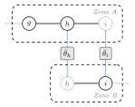
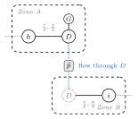
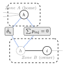

# Coupling and sectioning

A distributed run makes two independent choices. **Sectioning** decides how the grid is cut into zones and what happens to the buses on the boundary. **Coupling** decides which boundary quantities the zones have to agree on before the run is considered converged. You pass both to `admm(...)` or `aladin(...)`:

```julia
admm(coupling = :hybrid, sectioning = :tie_line)
aladin(coupling = :state, sectioning = :tie_line)
```

`coupling` is one of `:state`, `:power`, `:hybrid`. `sectioning` is one of `:tie_line`, `:dummy_bus`, `:split_bus`. The two choices are not fully independent: some combinations are not supported, and one combination behaves differently under ALADIN than under ADMM. The matrix in [Supported combinations](@ref) is the part worth reading carefully.

The zones themselves come from the `bus.zone` column of the case, so the input must already be partitioned into two or more zones that share at least one inter-zonal branch.

## Sectioning

All three strategies start from the same zones and differ only in how they treat the inter-zonal branches and the buses at their ends. Each one is drawn below under its own heading, in a shared style: a solid circle is a bus the zone owns, a dotted circle is a virtual (ghost) copy pulled in from a neighbour, solid lines are branches, dotted grey lines run off to the rest of the grid, and the dotted blue links tie each zone's own copy of a boundary quantity to the shared value in the grey consensus box.

### `:tie_line`

The zones overlap on the boundary buses. Each zone pulls in the buses one hop across its inter-zonal branches as extra (virtual) buses, and the tie-line itself stays in the model. A boundary bus therefore appears in more than one zone, and the zones reconcile it as the run proceeds. This is the default for both algorithms.

```@raw html
<figure style="margin:1.5rem auto;max-width:380px">
  <div style="background:#ffffff;border:1px solid rgba(0,0,0,0.12);border-radius:10px;padding:16px 12px;text-align:center">
    
  </div>
  <figcaption style="font-size:0.9em;opacity:0.72;margin-top:0.6rem">
  <strong>Tie-line.</strong> Both boundary buses <em>h</em> and <em>i</em> appear in both zones, one as the real bus and one as the dotted ghost copy, and the tie-line is kept in each. Each zone holds its own copy of the boundary state, and the dotted blue links drive those copies to one consensus value (their mean in ADMM, or a coordinator constraint in ALADIN). With <code>:state</code> that quantity is the bus state: the angle &#952; for DC, the angle and |V| for AC, and v&#178;, R, T for SOCWR. With <code>:power</code> it is the tie-line flow instead, and <code>:hybrid</code> couples both.
  </figcaption>
</figure>
```

### `:dummy_bus`

Each inter-zonal branch is cut in the middle by inserting one new dummy bus. The original line becomes two half-lines, each carrying half the series impedance, the line charging is moved back to the two original endpoints, and a zero-cost dummy generator is added at the dummy bus. There is a single dummy bus per tie, shared between the two zones: it is a real bus in the from-zone, which also holds the dummy generator and one half-line, and a virtual ghost in the to-zone, which holds the other half-line. The zones then agree on the power flowing through the dummy bus. Because the thing being reconciled is a flow, `:dummy_bus` only makes sense with a coupling that carries power (see the matrix).

```@raw html
<figure style="margin:1.5rem auto;max-width:380px">
  <div style="background:#ffffff;border:1px solid rgba(0,0,0,0.12);border-radius:10px;padding:16px 12px;text-align:center">
    
  </div>
  <figcaption style="font-size:0.9em;opacity:0.72;margin-top:0.6rem">
  <strong>Dummy-bus.</strong> The tie-line is cut by one shared dummy bus <em>D</em>. The line becomes two half-lines, each with half the series impedance, the charging moves back to the two endpoints, and a zero-cost generator <em>G</em> is added at <em>D</em>. That single <em>D</em> is a real bus in the from-zone, where it carries <em>G</em>, and a dotted ghost in the to-zone. The reconciled quantity is the power flowing through <em>D</em>: each zone owns one half-line flow, and the dotted blue links drive the two half-flows to agree, which is continuity through <em>D</em>. AC and SOCWR reconcile the reactive flow <em>q</em> as well, and under <code>:hybrid</code> the voltage state at <em>D</em> is reconciled too. This needs <code>:power</code> or <code>:hybrid</code>, never <code>:state</code>.
  </figcaption>
</figure>
```

### `:split_bus`

Each inter-zonal branch is given a single owner zone, the zone of its to-bus, and the branch stays wholly inside that owner with its full impedance. The neighbouring (from) zone's boundary bus is cloned into the owner as a ghost with its load, shunt, and generation zeroed. Because `:split_bus` runs only under `:hybrid`, the shared bus is reconciled in two ways at once: its boundary state is driven to agree across the copies, and the net injections the sharing zones attribute to it are tied by an **injection consensus**, so that they sum consistently (the N-way case, where a bus is shared by three or more zones, is handled the same way). Both reconciliations live only in the hybrid workspaces, which is why `:split_bus` requires `:hybrid`.

```@raw html
<figure style="margin:1.5rem auto;max-width:380px">
  <div style="background:#ffffff;border:1px solid rgba(0,0,0,0.12);border-radius:10px;padding:16px 12px;text-align:center">
    
  </div>
  <figcaption style="font-size:0.9em;opacity:0.72;margin-top:0.6rem">
  <strong>Split-bus.</strong> The inter-zonal branch is owned wholly by one zone, the zone of its to-bus, and stays there with its full impedance. The from-bus is cloned into that owner as a dotted ghost with its load, shunt, and generation zeroed. Because split-bus runs only under <code>:hybrid</code>, the shared bus is reconciled two ways at once: its boundary state (the angle &#952;, plus |V| for AC or v&#178; for SOCWR) is driven to agree across the copies, and the per-zone net injections are constrained to sum to zero (&#931;&#8201;<em>p</em><sub>inj</sub> = 0, plus <em>q</em><sub>inj</sub> for AC and SOCWR). A bus shared by three or more zones is summed the same way.
  </figcaption>
</figure>
```

## Coupling

Coupling selects which boundary quantities enter the consensus. What `:state` means depends on the model, because each formulation carries a different boundary state.

- **`:state`** — the boundary voltage state only.
  - DC: the bus angle `θ`.
  - AC: the bus angle `θ` and the voltage magnitude `V`.
  - SOCWR: the W-space boundary quantities, the squared voltage magnitude `v²` and the real and imaginary voltage-product terms `R` and `T`.
- **`:power`** — the branch flows across the boundary only.
  - DC: the active flow `p`.
  - AC and SOCWR: the active and reactive flows `p` and `q`.
- **`:hybrid`** — both the state and the power.

Each `(model, coupling)` pair has its own set of penalty parameters (`rho`). In practice you pass a single `rho = ...` and Lirion fills in the ones that pair needs; the per-block names and the adaptive updates are described in [ADMM settings](@ref) and [ALADIN settings](@ref).

## Supported combinations

This is the full matrix. A ✓ is a combination you can run; a ✗ raises an `ArgumentError` at solve that prints the allowed options.

| `coupling` | `sectioning` | ADMM | ALADIN |
|:--|:--|:--:|:--:|
| `:state`  | `:tie_line`  | ✓ | ✓ |
| `:state`  | `:dummy_bus` | ✗ | ✗ |
| `:state`  | `:split_bus` | ✗ | ✗ |
| `:power`  | `:tie_line`  | ✓ | ✓ |
| `:power`  | `:dummy_bus` | ✓ | ✓ (✗ for SOCWR) |
| `:power`  | `:split_bus` | ✗ | ✗ |
| `:hybrid` | `:tie_line`  | ✓ | ✓ |
| `:hybrid` | `:dummy_bus` | ✓ | ✓ (✗ for SOCWR) |
| `:hybrid` | `:split_bus` | ✓ | ✓ |

The **ADMM** column is the same for every model (DC, AC, SOCWR, SOCWRNL). The **ALADIN** column is the same for DC, AC, and SOCWRNL; the two "(✗ for SOCWR)" cells are where ALADIN on the conic SOCWR model is more restrictive, as explained below.

Read as rules:

- **`:state` works only with `:tie_line`.** State consensus is defined on the shared boundary buses, which only `:tie_line` keeps. With `:dummy_bus` the consensus quantity is a flow, and `:split_bus` needs `:hybrid`, so both are rejected.
- **`:power` works with `:tie_line` or `:dummy_bus`.** It is rejected with `:split_bus`, whose injection consensus exists only under `:hybrid`.
- **`:hybrid` works with all three.** It is the only coupling that unlocks `:split_bus`.
- **`:dummy_bus` needs `:power` or `:hybrid`.** With `:state` the flow across the dummy bus would be uncoupled while the dummy generators inject power at zero cost, which is not a valid decomposition.
- **`:split_bus` needs `:hybrid`.**

### The ALADIN + SOCWR exception

**ALADIN does not support `:dummy_bus` on the SOCWR model, for any coupling.** The coordinator QP converges to a relaxed solution in that case, so the combination is rejected rather than run silently. Concretely, under ALADIN + SOCWR the two dummy-bus cells above become unavailable:

- `:power` works with `:tie_line` only.
- `:hybrid` works with `:tie_line` or `:split_bus`.

`:tie_line` and `:split_bus` are unaffected. If you need SOCWR with `:dummy_bus`, use ADMM, which supports it for `:power` and `:hybrid`.

Trying the unsupported combination raises an error instead of producing a result:

```julia
# ALADIN + SOCWR + :dummy_bus is NOT supported — this raises ArgumentError
solve("paper/cases/partitioned/case24_ieee_rts/std/k3/case.m";
    model = socwr(),
    algorithm = aladin(coupling = :hybrid, sectioning = :dummy_bus),
)
# ArgumentError: ALADIN is not supported for SOCWR + DummyBus sectioning ...
# Use ADMM for this combination, or switch sectioning to :tie_line / :split_bus for ALADIN on SOCWR.
```

!!! note "SOCWRNL"
    `socwrnl()` is a smooth-NLP sibling of `socwr()` that solves the same W-space relaxation with a nonlinear solver. Under ALADIN it is *not* subject to the exception above: it follows the DC/AC column and supports `:dummy_bus` with `:power` or `:hybrid`. The `socwr()` conic model is the one that drops `:dummy_bus` under ALADIN.

## Examples

Every combination shown here is valid. The examples use the three-zone partition of the IEEE RTS 24-bus case ([PGLib-OPF](https://github.com/power-grid-lib/pglib-opf)) shipped with Lirion at `paper/cases/partitioned/case24_ieee_rts/std/k3/case.m`. A distributed run needs a case whose `bus.zone` column defines at least two zones, so a single-zone case would raise.

Hybrid coupling on tie-lines, the ADMM default:

```julia
using Lirion

result = solve("paper/cases/partitioned/case24_ieee_rts/std/k3/case.m";
    model = ac(),
    algorithm = admm(coupling = :hybrid, sectioning = :tie_line, rho = 1e3),
)
```

State coupling on tie-lines, the ALADIN default:

```julia
result = solve("paper/cases/partitioned/case24_ieee_rts/std/k3/case.m";
    model = dc(),
    algorithm = aladin(coupling = :state, sectioning = :tie_line),
)
```

Power coupling across dummy buses:

```julia
result = solve("paper/cases/partitioned/case24_ieee_rts/std/k3/case.m";
    model = dc(),
    algorithm = admm(coupling = :power, sectioning = :dummy_bus, rho = 1e3),
)
```

Hybrid coupling with cloned boundary buses:

```julia
result = solve("paper/cases/partitioned/case24_ieee_rts/std/k3/case.m";
    model = ac(),
    algorithm = admm(coupling = :hybrid, sectioning = :split_bus, rho = 1e3),
)
```

SOCWR under ALADIN, which is fine on tie-lines (and on `:split_bus` with `:hybrid`):

```julia
result = solve("paper/cases/partitioned/case24_ieee_rts/std/k3/case.m";
    model = socwr(),
    algorithm = aladin(coupling = :hybrid, sectioning = :tie_line),
)
```

## Where to go next

- [ADMM settings](@ref) — penalties, adaptive `rho`, and stopping tolerances.
- [ALADIN settings](@ref) — proximal mode, stopping criterion, and the coordination step.
- For what `result` holds, see the Decentralized section of [Results](@ref).
